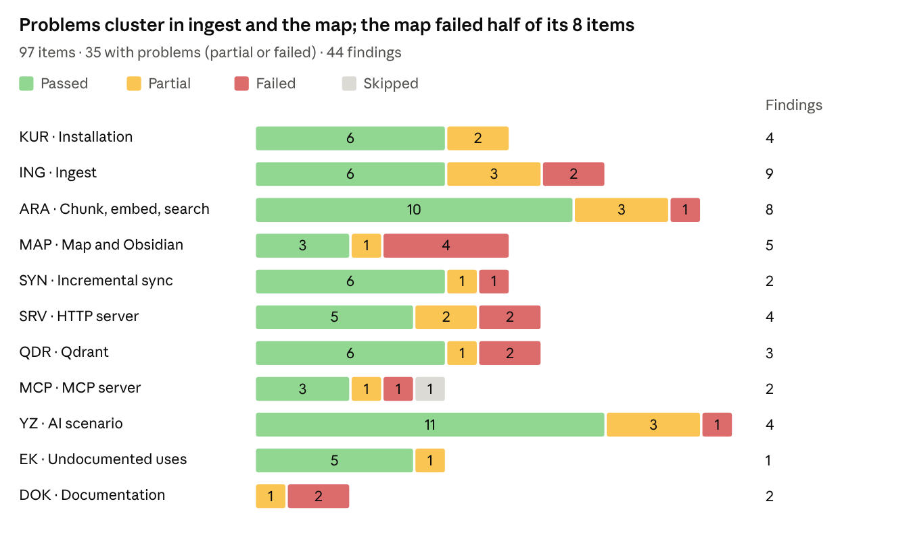
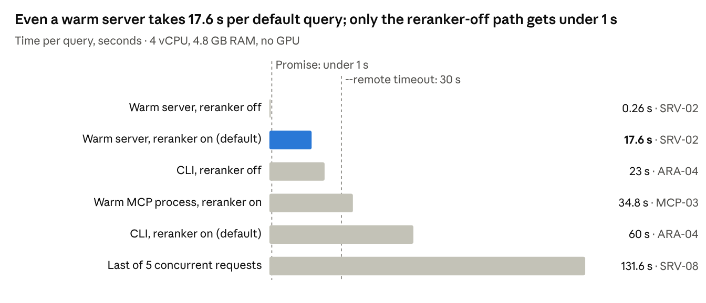

# doqqy Manual Test Report

29 October 2026 · Turhan Göksu

## Summary

Most of doqqy's promised features work on an Ubuntu server, but 35 of 97 test items hit problems and 44 findings were logged, 9 of them high severity. Testing ran manually from 20 to 29 October 2026 on commit fd1ba07 (doqqy 0.1.6).

61 items passed, 19 passed partially, 16 failed and 1 was skipped. Of the 44 findings, 9 are high, 24 medium and 11 low severity; none is critical.

- **The core works.** All nine file formats were ingested, and Turkish, English and cross-language search find the right documents. sync, the HTTP server, Qdrant, MCP and use through an AI agent all work.
- **CPU performance is far below the promise.** A default query on a warm server takes 17.6 s (promised: under 1 s); it only drops below 1 s with the reranker off (0.26 s). Every CLI query takes 60–93 s, and a 35-page PDF takes about 10 min.
- **Some flows silently produce wrong data.** The documented "documents changed" flow re-indexes deleted documents. Most of a large TXT file is not searchable. The map mixes up files that share a name. A running server or MCP process does not see a later sync.
- **Two optional features are broken on a fresh install.** Dependency ranges have no upper bound, so `doqqy mcp` does not start (mcp 2.x) and the PDF fallback parser installs an empty package (pymupdf4llm 2.0). CI catches neither.
- **Security and privacy claims do not fully hold.** A server started with `--host 0.0.0.0` has no authentication. Every model load tries to reach HuggingFace. Used through MCP, document chunks go to a cloud model, and the docs do not say so.
- **The docs are out of date.** Shipped features are still listed as "to do", and four of eight numeric claims do not match measurements.

Every item's commands, output and notes are in the test notebook (in Turkish): [test-notebook.html](test-notebook.html). GitHub does not render HTML files as pages, so download it and open it in a browser.

## Test environment and method

The tests followed the install and usage instructions in the docs, run by hand on an Ubuntu virtual machine. The docs are written for Windows/PowerShell, so commands were translated to Linux and every point of friction was logged.

| Component | Value |
| --- | --- |
| Host | MacBook Air M3, 8 GB RAM |
| Virtual machine | Multipass; Ubuntu 24.04.5 LTS (aarch64); 4 vCPU, 4.8 GB RAM, 8 GB swap, 33 GB disk; no GPU |
| doqqy | 0.1.6, commit fd1ba07 (17 September 2026); Python 3.12.3 in a venv |
| Extras | server, watch, qdrant, ocr, mcp, dev; mcp 2.3.0 was installed and downgraded to 1.30.0 (MCP-02) |
| Qdrant | Docker, qdrant/qdrant v1.13.2; qdrant-client 1.19.1 |
| AI clients | Claude Code 2.1.310 (VM and Mac), Claude Desktop (Mac); model Claude Opus 5.5 |

**Corpora**

- `~/corpus`: the repo's evaluation corpus (13 fictional "Nova Ticaret" documents), generated fictional files in every format, and 5 real files (a CV, a 35-page PDF, a 20 MB DOCX, an HTML page, a CSV). 41 documents, 239 chunks.
- `~/corpus2`: ERP documents only; used for the one-server, many-corpora tests.
- `~/corpus-nova`: fictional documents only (14). The AI scenario sends chunks to the cloud, so no real files were used there.

**Who did what**

- Turhan Göksu ran every test command on the VM by hand. Durations were measured with `time`, memory with `/usr/bin/time -v`.
- Claude (Claude Code, Opus 5.5) read the repo, prepared the test plan and commands, drafted notes and findings from the output, and compiled this report. As the task asked, it also proposed the undocumented uses and the AI scenario.
- Expectations derived from reading the code were marked "suspect" in the notebook and each was confirmed or refuted by hand.
- On the last day, at Turhan's request, Claude did the environment clean-up and inspected one Claude Desktop session log (MCP-06).

**Item codes** refer to the test notebook: KUR = installation, ING = ingest, ARA = chunk, embed and search, MAP = map and Obsidian, SYN = incremental sync, SRV = HTTP server, QDR = Qdrant, MCP = MCP server, YZ = AI scenario, EK = undocumented uses, DOK = documentation.

**Status and severity**

| Status | Meaning |
| --- | --- |
| Passed | The step worked as documented. Any side issue was logged separately as a finding (13 items). |
| Partial | It worked, but part of the promise did not hold or an extra step was needed. |
| Failed | It did not work as documented, or gave a wrong result. |
| Skipped | Not run; the reason is in the note. |

| Severity | Criterion used |
| --- | --- |
| High | Wrong or missing results in default use, a security gap, or a main feature not working |
| Medium | A problem under specific conditions, or one with a workaround |
| Low | Documentation, message or usability issue |

## Coverage and results

The test covered every component the docs describe, in 11 sections and 97 items. Problems clustered in ingest, the map and the HTTP server.

_Source: doqqy test notebook, 29 October 2026 · 97 items, 44 findings_

- **Installation:** Works, but the docs are written for PowerShell. A machine without a GPU downloads 4.1 GB of CUDA libraries; the "fast" tests download 6.4 GB of models.
- **Ingest:** All nine formats were ingested. Output of deleted sources is not cleaned up, cp1254 Turkish text is garbled, and the PDF fallback parser is broken.
- **Chunk, embed and search:** Hybrid search and the reranker bring the right documents to the top. Large TXT files are unsearchable, and there is no threshold for irrelevant results.
- **Map and Obsidian:** The map is generated and opens in Obsidian. Same-named files, underscores in names, the inject cycle and the INDEX.md leak produce wrong links.
- **Incremental sync:** sync handles add, modify, delete and duplicates correctly. watch works but its output is noisy.
- **HTTP server:** Keeps models in memory and survives concurrent requests. A default query takes \~17 s, it does not see other processes' syncs, and it has no authentication when exposed.
- **Qdrant:** Embed, query, migrate-store, evaluation and integration tests work. Data silently disappears when the corpus folder moves.
- **MCP:** With mcp 1.x all three tools work; on a default install (mcp 2.x) the server does not start.
- **AI scenario:** With the right setup, 10 of 10 answers were correct; the errors came from setup and staleness.
- **Undocumented uses:** Six of eight worked without problems.
- **Documentation:** All three checks found contradictions.

## High-severity findings

Six of the nine high-severity findings produce wrong or missing results without showing the user an error. The other three concern performance, security and installation. The code in brackets is the item number in the test notebook.

1. **The documented full rebuild re-indexes deleted documents (ING-07).** `doqqy ingest` does not delete the `processed/` output of a source removed from `raw/`. The `ingest && chunk && embed` flow recommended in USAGE:294–297 then embeds that orphan again. In SYN-07 the deleted document filled all three of the top 3 results for its query. The path that handles deletes correctly is `doqqy sync`.
2. **Most of a large TXT file cannot be searched (ARA-08).** TXT content is wrapped in a single code block and the chunker never splits code blocks; by the code, XML behaves the same. A 31 KB TXT became one chunk (9,016 tokens) and embedding truncated it at 1,024 tokens. Only the first \~11% is searchable, and `doqqy sync` truncates without a warning.
3. **Links between same-named files in different folders get mixed up (MAP-06).** The map and inject identify documents by file name only. Two `politika.md` files were treated as one: section IDs collided and both received the same link block. In real corpora with common names such as README.md this becomes systematic.
4. **Links added by inject count as "explicit references" on the next map (MAP-07).** Pass 1 does not exclude `[[...]]` links inside the `## Bağlantılar` block. One map → inject → map cycle raised explicit references from 3 to 81 with no change to the documents.
5. **INDEX.md and link blocks leak into the index (MAP-08).** `doqqy chunk` does not exclude them: 132 of 429 chunks came from INDEX.md and 88 from link blocks. Search returns a non-existent `raw/INDEX.md` source, and `doqqy sync` deletes `processed/INDEX.md`.
6. **A default query takes \~17 s even on a warm server (SRV-02).** About 98% of the time is the reranker on CPU: 50 candidates scored in batches of 4, both hard-coded (`config.RETRIEVAL_TOP_K`). With the reranker off a query takes 0.26 s, but cross-language search on LanceDB then breaks (QDR-08).
7. **A running server or MCP process does not see another process's sync (SRV-06).** The LanceDB table handle is cached in-process (`_TABLE_CACHE`). A document added by sync never appears and a deleted one keeps appearing until restart. The same happened in a Claude Code session (YZ-12).
8. **No authentication when the server listens on `--host 0.0.0.0` (SRV-07).** A client can name any indexed folder on the server as its workspace; in the test, another corpus was read over the network. The 404 versus 409 difference lets a client probe the file system. The default 127.0.0.1 is safe.
9. **`doqqy mcp` does not start on a default install (MCP-01).** The `[mcp]` extra allows `mcp>=1.29.0,<3` (Dependabot, d5a6ec2), and mcp 2.x has no `mcp.server.fastmcp` module. The error message suggests a command that does not fix it. Workaround: `pip install "mcp>=1.29,<2"`.

Four medium findings also stand out: the PDF fallback installing an empty package (ING-11), Turkish cp1254 files being garbled (ING-09), the offline claim (EK-01) and the missing privacy note for MCP (YZ-13). Appendix A lists all findings.

## Performance and delays

On CPU with default settings, interactive use is slow: a query takes 17.6 s on a warm server and 60 s from the CLI. It only gets below 1 s with the reranker off.

_Source: doqqy test notebook (SRV-02, ARA-04, MCP-03, SRV-08) · queries "fatura iptal onayı" and "stok sayımı"_

About 98% of the time is spent in the reranker. With the reranker off, however, cross-language search on LanceDB breaks (QDR-08). The CLI reloads the models on every query; the first query of the day took 93 s.

**Batch operations**

| Operation | Measured | Documented expectation | Item |
| --- | --- | --- | --- |
| Base install (`pip install -e .`) | 14 min 17 s; `.venv` 6.6 GB, of which 4.1 GB CUDA | – | KUR-03 |
| "Fast" tests (`pytest -m "not slow"`) | 15 min 2 s, including a 6.4 GB model download | No model download | KUR-07 |
| Ingest of a 35-page PDF | 15 min 19 s on the first run, then 9 min 46 s | 500 pages in 15–30 min | ING-02 |
| Embed, 206 chunks (CPU) | 9 min 3 s | 500 pages in 15–30 min | ARA-02 |
| Full flow, 41 documents (ingest + chunk + embed) | \~27 min | – | SYN-07 |
| Embed to Qdrant, 239 chunks | 14 min 19 s | – | QDR-02 |
| LanceDB to Qdrant (`migrate-store`) | 2.5 s | – | QDR-04 |
| Single-document sync | 16–27 s, mostly model loading | – | SYN-02, YZ-12 |
| Server ready | +8 s (models in disk cache) | – | SRV-01 |
| Evaluation tool (25 queries, two modes) | LanceDB 28 min 40 s, Qdrant 17 min 36 s | – | QDR-08 |
| Offline query | 48.7 s; 38.0 s with `HF_HUB_OFFLINE=1` | – | EK-01 |
| AI agent answering one question | 16 s – 1 min 33 s, \~53 s on average | – | YZ-14 |

## Undocumented uses suggested by AI

Six of the eight uses Claude suggested worked without problems; two needed extra settings. None of them is described in the docs.

| Use | Item | Result | Observation |
| --- | --- | --- | --- |
| Searching through the server's Swagger UI (`/docs`) | SRV-03, EK-05 | Passed | A ready-made UI for non-technical users, but the workspace field needs the absolute path on the server. |
| One server for several corpora | EK-03 | Passed | Results of three corpora stayed separate. The same feature becomes a security gap when the server is exposed (SRV-07). |
| Calling the MCP tools from a Python client | MCP-03 | Passed | No Node.js needed; all three tools worked and the server's stderr stayed empty. |
| MCP over SSH from another computer | YZ-02, MCP-06 | Partial | Worked directly in Claude Code. Claude Desktop needed `-o UseKeychain=yes` for a passphrase-protected key. |
| Running the evaluation tool on your own data | QDR-08, EK-04 | Passed | Measures Recall@k and MRR; a full run took 28 min 40 s on LanceDB and 17 min 36 s on Qdrant. |
| Working without internet | EK-01 | Partial | Queries and sync work, but every model load makes 3 attempts to reach HuggingFace. `HF_HUB_OFFLINE=1` is undocumented. |
| Packing a corpus and moving it | EK-02 | Passed | A 491 KB archive worked as-is with LanceDB. On Qdrant the data is tied to the folder path and cannot move (QDR-06). |
| Running in a Docker container with no network | EK-06 | Passed | With `--network none` a query returned the right result in 36.9 s; the strongest evidence for the "data stays on the machine" claim. |

## AI usage scenario

With the right setup, Claude Code with doqqy answered all 10 questions about fictional company documents correctly and with sources, in about 53 s per question on average. The wrong answers came from the setup and from doqqy's MCP behaviour.

**Scenario.** An employee of "Nova Ticaret" asks an AI agent about the company's HR and ERP documents. The agent is Claude Code (Opus 5.5), connected to doqqy over MCP. The corpus holds fictional documents only (13 documents, 92 chunks). The agent was isolated: only doqqy was connected (`--strict-mcp-config`), file tools were disabled, and Claude was started from a folder outside the corpus. It was connected both inside the VM (YZ-01) and from the Mac over SSH (YZ-02). Questions were asked in Turkish except the language-trap one; English translations below.

| Question type | Question | doqqy calls | Time | Result |
| --- | --- | --- | --- | --- |
| Status (YZ-03) | Summarise the state of the doqqy document store. Which tags exist? | 2 | 16 s | Correct |
| First query (YZ-04) | How does the invoice cancellation process work? | 1 | 50 s | Correct |
| Factual (YZ-05) | Who approves cancelling an invoice of 5,000 TL or more? What if approval does not arrive within 48 hours? | 1 | 43 s | Correct; also spotted a 48/72-hour contradiction in the document |
| Language trap (YZ-06) | Who approves the cancellation of a 6,000 TL invoice at the Turkish company? | 3 | 1 min 12 s | Correct; translated the query into Turkish |
| Calculation (YZ-07) | At our company (Nova Ticaret), how many days of annual leave does a 20-hour-a-week employee with 7 years' service get? | 2 | 36 s | Correct (10 days). Wrong (20 days) when the company was not named |
| Comparison (YZ-08) | Compare the leave request processes of the Turkish and UK companies. | 3 | 58 s | Correct (4 of 4 differences) |
| Tags (YZ-09) | Looking only at stock documents: what happens if a handheld terminal loses its connection? | 2 | 30 s | Correct; used the `stok` tag on its own |
| Exact term (YZ-10) | Which document mentions invoice NOVA2026000123? | 1 | 1 min 5 s | Correct |
| Hallucination test (YZ-11) | How is payroll calculated at Nova Ticaret? (no answer in the corpus) | 3 | 1 min 18 s | Correct: "not in the documents" |
| Live update (YZ-12) | How many days of marriage leave at Nova Ticaret? (document added during the session) | 3, then 1 | 1 min 33 s, 1 min 21 s | Wrong; correct after reconnecting MCP |

**Observations**

- **The agent adds value over plain search.** On the language-trap question, `doqqy query` returned the UK document for all top 3 results and would have led to a wrong answer. On the question with no answer, plain search showed unrelated hits as normal results; the agent said "not in the documents".
- **With the setup from USAGE the agent bypasses doqqy (YZ-05).** Started from the corpus folder, Claude scanned and read the files directly; in that case whole documents go to the cloud.
- **If the question does not name the company, doqqy is not called (YZ-07).** The MCP server sends no description of the corpus; the agent took it for a general question and answered from labour law, contradicting company policy.
- **A running MCP process does not see new documents (YZ-12).** A document added by sync was not found until the session reconnected (same root cause as SRV-06).
- **Privacy (YZ-13).** doqqy runs locally, but the chunks it returns go to the cloud model to produce the answer. In a default Claude Code setup the account's Gmail, Drive and Calendar connectors are also available to the agent.
- **Claude Desktop (MCP-06).** Manual JSON configuration worked, but SSH needed an extra option, and with the reranker on the first two queries timed out. While the connection was failing, the agent searched with Spotlight and Google Drive without asking.

The cost: about 1 min of waiting per question, chunks going to the cloud, and a careful setup (isolation, company context, reconnecting after a sync).

## Documentation consistency

Four of the docs' eight numeric claims do not match measurements, and instructions grouped under 12 headings do not work as written. Shipped features are also still described as "to do". Line numbers refer to commit fd1ba07.

**Numeric claims vs measurements (DOK-02)**

| Claim | Source | Measured | Verdict |
| --- | --- | --- | --- |
| \~2 GB model download, on the first embed | README:39, USAGE:32, ARCHITECTURE:291 | 6.4 GB; 6.9 GB with docling models (KUR-07, ING-02) | Does not hold |
| Cold CLI query \~20–60 s | USAGE:186, README:117 | 60–93 s with reranker, 23 s without (ARA-04) | Does not hold |
| Warm query under 1 s | USAGE:199, ARCHITECTURE:289 | 17.6–21.5 s with reranker, 0.26 s without (SRV-02) | Only with reranker off |
| 500 mixed pages in 15–30 min (2–4 s/page) | ARCHITECTURE:285 | 35-page PDF in 9 min 46 s, \~16.7 s/page (ING-02) | Does not hold |
| Chunk under 1 min | ARCHITECTURE:286 | 206 chunks in 1.6 s (ARA-01) | Holds |
| Embed (CPU) 15–30 min | ARCHITECTURE:287 | 206 chunks in 9 min 3 s; \~15 min scaled to 500 pages (ARA-02) | Holds |
| RAM-constrained defaults | README:104, ARCHITECTURE:118 | Embed 2.9 GB; query 4.3 GB, ingest 4.7 GB (on a 4.8 GB VM) | Partly |
| Evaluation results | VECTOR-STORE-ADAPTERS:231 | Identical with reranker on; with it off, Qdrant MRR 0.7593 (documented 0.7793) | Partly |

The performance table (ARCHITECTURE §5) does not say what hardware the numbers came from.

**Instructions that do not work as written (DOK-03)**

- Installation is written for PowerShell only; on Ubuntu the `python` command and the `python3-venv` package are missing (KUR-02, KUR-06).
- The install section omits `.[server]` (KUR-05). USAGE:272 says "mcp<2", pyproject installs "<3", and `doqqy mcp` does not start (MCP-01, MCP-05).
- CLAUDE.md and DEVELOPER-HANDOVER say the "not slow" tests download no models; 6.4 GB was downloaded (KUR-07).
- `--ocr` (USAGE:81, 373) has no effect on scanned PDFs because docling already runs OCR (ING-04).
- USAGE:373 and the error message suggest `.[pdf-fallback]` for the fallback parser; that extra now installs an empty package (ING-11).
- The "Documents added or changed" flow (USAGE:294–297) re-indexes deleted documents and pulls INDEX.md into the index (ING-07, SYN-07, MAP-08).
- The FAQ error message (USAGE:369) differs from the real one (ARA-09); the §5 Python example crashes as written (ARA-12).
- watch's "single summary line" (USAGE:161) is lost among model-loading output (SYN-08).
- `claude mcp add doqqy -- doqqy mcp` (USAGE:401) only works with the venv active (YZ-01). §7 does not cover connecting to doqqy on a server (MCP-06).
- `--host` is only described as "custom host" (USAGE:206); nothing says there is no authentication (SRV-07).
- "Fully offline" (README:39, USAGE:32) and "no external API calls" (README:126): every model load tries to reach HuggingFace (EK-01).
- ".doqqy/ can be zipped and moved" (ARCHITECTURE:276) holds for LanceDB, not Qdrant (EK-02, QDR-06).

**Outdated text (DOK-01).** USAGE:294 says "no incremental mode yet" and USAGE:371 "serve mode is on the roadmap"; the README roadmap still lists Qdrant, serve and sync/watch as to do. Supported formats are counted differently in three places (five, eight, four; actually nine). `.env.example` asks for GEMINI and ANTHROPIC API keys "needed for the map", which the code never uses.

**Behaviour the docs never mention:** the Swagger UI at `/docs`, one server serving several corpora, the `python -m tests.eval` evaluation tool, `HF_HUB_OFFLINE`, the server and MCP process not seeing other processes' syncs, and Qdrant data being tied to the folder's absolute path.

## Priority recommendations

The quickest wins are capping two dependencies and replacing the documented "documents changed" flow with `doqqy sync`. These follow from the findings; how to fix them is the developers' call.

1. **Pin dependencies.** `mcp>=1.29,<2` and `pymupdf4llm>=0.0.17,<2` (or port the code to mcp 2.x and PyMuPDF 2.x). Add the `[mcp]` and `[pdf-fallback]` extras and the MCP integration tests to CI (MCP-01, ING-11, MCP-05).
2. **Close the silent data errors.** ingest should remove output for deleted sources; chunk should skip INDEX.md and link blocks. The map should identify documents by full path and keep inject blocks out of Pass 1. Large TXT/XML blocks should be split, and sync should warn about truncation too (ING-07, MAP-06, MAP-07, MAP-08, ARA-08).
3. **Keep the server and MCP current.** The LanceDB table cache should detect writes by other processes, or the docs should state that a restart is needed (SRV-06, YZ-12).
4. **CPU performance.** Make the reranker candidate count and batch size configurable. Make the `--remote` timeout configurable and show a clear message instead of a traceback. Update the documented timings together with the hardware they were measured on (SRV-02, SRV-05, ARA-04).
5. **Security and privacy.** Add authentication for `--host 0.0.0.0`, or at least a workspace allow-list and a warning. Make offline mode (`HF_HUB_OFFLINE`) the default or document it. Add a privacy note and an isolated setup example to the MCP section (SRV-07, EK-01, YZ-13, YZ-05).
6. **Turkish support.** Use cp1254 as the fallback encoding for TXT, MD and XML; make the Pass 1 pattern accept file names starting with Ö, Ş, Ç, Ü, İ (ING-09, MAP-02).
7. **Let the MCP server describe itself.** Passing FastMCP an `instructions` text that explains the corpus would help agents pick doqqy for company questions (YZ-07).
8. **Update the docs.** Linux install commands, format lists, roadmap, `.env.example`, numeric claims, and connecting to doqqy on a server over MCP (DOK-01, DOK-02, DOK-03, MCP-06).

## Not tested

Windows and GPU were out of scope because the test environment had neither; the other gaps were skipped for a stated reason or covered another way.

| Topic | Reason |
| --- | --- |
| Windows and PowerShell (the docs' main platform) | The task asked for a server test; the environment was an Ubuntu VM on a Mac. |
| GPU and CUDA | No GPU on the machine; all timings are CPU. |
| Python 3.10 and 3.11 | CI already tests 3.10. Tests ran on 3.12, which CI never covers. |
| python-pptx fallback parser | Cannot be triggered: docling's PPTX reader itself uses python-pptx (ING-11). |
| Cursor and Windsurf | Covered with Claude Desktop, which uses the same JSON configuration (MCP-06). |
| MCP Inspector | Needs Node.js; the tools were tested with the Python MCP client instead (MCP-03, MCP-04). |
| A full evaluation run on your own question set | Only the options were reviewed (EK-04); the repo's set was run in full (QDR-08). |
| Large corpora | The corpus had 41 documents and 239 chunks; tens of thousands of chunks were not tried. |
| Long-running and multi-user use | Only 5 concurrent requests were tried (SRV-08). |

The VM's DNS resolution was intermittent throughout; some timings that include model loading may be affected (EK-01).

## Appendices

**Appendix A. All findings (44)**

Sorted by severity, then by item. Details and evidence for each finding are in the test notebook.

| Severity | Item | Area | Finding |
| --- | --- | --- | --- |
| High | ING-07 | Ingest | ingest does not clean up output of deleted sources; the documented full flow re-indexes deleted documents |
| High | ARA-08 | Search | Most of a large TXT file is unsearchable; sync gives no warning |
| High | MAP-06 | Map | Links between same-named files in different folders get mixed up |
| High | MAP-07 | Map | Links added by inject count as "explicit references" on the next map |
| High | MAP-08 | Map | INDEX.md and link blocks leak into the index; sync deletes INDEX.md |
| High | SRV-02 | Performance | Even a warm server takes \~17 s per query; "<1 s" only holds with the reranker off |
| High | SRV-06 | HTTP server | Server and MCP process do not see syncs made while they run; added documents are missing, deleted ones still returned |
| High | SRV-07 | Other | No authentication with --host 0.0.0.0; every indexed folder on the server is readable over the network |
| High | MCP-01 | MCP | doqqy mcp does not start on a default install (mcp 2.x incompatible); the error message suggests the wrong fix |
| Medium | KUR-02 | Docs | Install commands do not work as-is on Ubuntu |
| Medium | KUR-03 | Install | Unneeded CUDA libraries are downloaded on a machine without a GPU |
| Medium | ING-02 | Performance | PDF ingest is far slower than documented |
| Medium | ING-03 | Ingest | The mammoth fallback scatters DOCX tables and mangles punctuation |
| Medium | ING-04 | Docs | The --ocr flag has no effect; scanned PDFs are OCRed anyway |
| Medium | ING-05 | Ingest | Misleading error messages; the install command shown on screen is broken |
| Medium | ING-08 | Ingest | --source fails outside the corpus and flattens the folder structure inside it |
| Medium | ING-09 | Ingest | Turkish files in Windows-1254 encoding are silently garbled |
| Medium | ING-11 | Ingest | The \[pdf-fallback\] extra installs an empty package; the PDF fallback parser is silently disabled |
| Medium | ARA-01 | Search | Chunks consisting of a heading only |
| Medium | ARA-02 | Search | Chunks are capped by characters; the end of some is unsearchable |
| Medium | ARA-04 | Performance | Every CLI query costs 1–1.5 min and \~4.3 GB of memory |
| Medium | ARA-07 | Search | With closely related documents, a wrong result can rank first |
| Medium | ARA-08 | Search | Irrelevant results come back with low scores instead of "no results" |
| Medium | ARA-09 | Search | Precondition errors show as tracebacks; query loads the models before failing |
| Medium | MAP-02 | Map | Explicit references miss file names with Turkish characters |
| Medium | MAP-05 | Map | File names with underscores produce broken wikilinks |
| Medium | SRV-05 | HTTP server | A --remote query dies with a Python traceback after 30 s while the server starts or is busy |
| Medium | QDR-06 | Qdrant | On Qdrant, data silently disappears when the corpus folder is moved or renamed |
| Medium | QDR-08 | Search | With the reranker off, cross-language search fails on the default backend (LanceDB) |
| Medium | YZ-05 | MCP | With the recommended Claude Code setup the agent bypasses doqqy and reads the files directly |
| Medium | YZ-07 | MCP | When the question names neither the company nor doqqy, the agent skips doqqy and answers from general knowledge |
| Medium | YZ-13 | MCP | Through MCP, document chunks go to a cloud AI model; the docs do not say so |
| Medium | EK-01 | Other | "Fully offline" is not quite true: every model load tries to reach HuggingFace |
| Low | KUR-04 | Docs | README command list is incomplete; the CLI has no --version |
| Low | KUR-07 | Docs | "Fast" tests download 6.4 GB of models |
| Low | ING-03 | Ingest | pandoc is silently downloaded from the internet during ingest |
| Low | ARA-12 | Docs | The Python example in USAGE crashes as written |
| Low | SYN-06 | Sync / watch | A corpus built only with sync has no chunks.parquet; info shows the wrong state and recovery via embed fails |
| Low | SYN-08 | Sync / watch | watch does not print "a single summary line": model-loading noise on every sync, tracebacks for bad files |
| Low | QDR-04 | Sync / watch | doqqy embed drops duplicate (alias) records from the manifest; the next sync reprocesses them needlessly |
| Low | MCP-06 | MCP | No documented way for an AI client to connect to doqqy running on a server |
| Low | YZ-01 | Docs | The MCP setup command in USAGE only works with the venv active |
| Low | DOK-01 | Docs | .env.example asks for LLM API keys "needed for the map" that the code never uses |
| Low | DOK-01 | Docs | Docs are out of date: shipped features listed as "to do", supported formats counted three different ways |

**Appendix B. Item results (97)**

Time is how long testing the item took; for some it includes setup and measurement work. "(completion)" items were added in the last days after the coverage review.

| Item | Test | Status | Time |
| --- | --- | --- | --- |
| KUR-01 | Virtual machine and Python version | Passed | - |
| KUR-02 | System packages | Partial | - |
| KUR-03 | Repo, venv and base install | Passed | 14 min 17 s |
| KUR-04 | CLI startup and command list | Passed | 0.25 s |
| KUR-05 | Optional extras | Passed | 43 s |
| KUR-06 | Linux equivalents of documented commands | Partial | - |
| KUR-07 | Unit tests and linter | Passed | 15 min 2 s |
| KUR-08 | Moving the model cache with HF\_HOME (completion) | Passed | \~2 min |
| ING-01 | First ingest with the bundled corpus | Passed | 0.21 s |
| ING-02 | One file of every format | Passed | 15 min 54 s |
| ING-03 | DOCX without pandoc | Passed | 9 s (pandoc download); mammoth fallback instant |
| ING-04 | Scanned (image) PDF and OCR | Partial | 32 s (without --ocr) / 11 s (with --ocr) |
| ING-05 | Broken files and failure isolation | Passed | 15.6 s |
| ING-06 | Tags from folder names | Passed | 14.5 s |
| ING-07 | Same-named sources (rapor.pdf + rapor.docx) | Partial | \~14 s per run |
| ING-08 | --limit and --source | Partial | under 1 s per run |
| ING-09 | Turkish character encoding (cp1254) | Failed | 13 s |
| ING-10 | Re-running (idempotency) | Passed | 10 min 14 s |
| ING-11 | Fallback parsers: pymupdf4llm and python-pptx (completion) | Failed | \~5 min |
| ARA-01 | Chunk | Passed | 1.6 s |
| ARA-02 | First embed: time and memory | Passed | 9 min 3 s |
| ARA-03 | First query (cold start) | Passed | 1 min 33 s |
| ARA-04 | Cold/warm time and --no-rerank | Passed | 60 s (with rerank) / 23 s (--no-rerank) |
| ARA-05 | Display options | Passed | \~23 s per query (--no-rerank) |
| ARA-06 | Tag filter | Passed | \~23 s per query; invalid tag instant |
| ARA-07 | Semantic and cross-language search | Partial | \~1 min per query |
| ARA-08 | End of a large TXT file | Failed | sync 27 s |
| ARA-09 | Wrong folder and missing steps | Partial | query 17.8 s, others under 1 s |
| ARA-10 | tags and info | Passed | instant |
| ARA-11 | Duplicate documents (dedup) | Passed | sync 32 s |
| ARA-12 | Python API (USAGE §5) | Partial | 1 min 1 s (example) + 49 s (fixed version) |
| ARA-13 | Is the code in mammoth output searchable? | Passed | \~3 min (separate folder: ingest + chunk + embed + 2 queries) |
| ARA-14 | Are garbled Turkish documents searchable? | Passed | \~1 min per query |
| MAP-01 | Map generation and options | Passed | 0.9–2.2 s per run |
| MAP-02 | Explicit references (Pass 1) | Partial | sync + map \~30 s |
| MAP-03 | INDEX.md and wikilink injection | Passed | under 1 s per command |
| MAP-04 | Visual check in Obsidian | Passed | - |
| MAP-05 | File name with underscores | Failed | sync + map + inject \~35 s |
| MAP-06 | Same-named files in different folders | Failed | sync + map + inject \~35 s |
| MAP-07 | map → inject → map cycle | Failed | \~2 s per cycle |
| MAP-08 | INDEX.md leaking into the index | Failed | chunk + embed 16 min |
| SYN-01 | Starting state | Passed | instant |
| SYN-02 | Add, modify, delete | Passed | \~3 min |
| SYN-03 | Move and rename | Passed | \~3 min |
| SYN-04 | Sync does not update the map | Passed | \~2 min |
| SYN-05 | Deleting the canonical copy | Passed | \~2 min |
| SYN-06 | New corpus with sync only | Partial | \~3 min |
| SYN-07 | Delete + full flow (without sync) | Failed | \~28 min |
| SYN-08 | watch | Passed | \~25 min (incl. editor trouble; test itself \~6 min) |
| SRV-01 | Startup and health endpoints | Passed | \~15 min (incl. measurement setup) |
| SRV-02 | Query with curl | Partial | \~5 min |
| SRV-03 | Error codes and Swagger UI | Passed | \~10 min |
| SRV-04 | Thin client with --remote | Passed | \~5 min |
| SRV-05 | Querying before ready, and timeouts | Failed | \~20 min (incl. port mix-up) |
| SRV-06 | Sync while the server runs | Failed | \~5 min |
| SRV-07 | Network exposure and security | Partial | \~5 min |
| SRV-08 | Concurrent requests | Passed | \~5 min |
| SRV-09 | Custom port and --remote URL (completion) | Passed | \~1 min |
| QDR-01 | Start Qdrant | Passed | \~3 min |
| QDR-02 | Embed and query on Qdrant | Passed | \~17 min |
| QDR-03 | Settings: environment variable and .env | Passed | \~2 min |
| QDR-04 | migrate-store | Passed | \~5 min |
| QDR-05 | With Qdrant down | Partial | \~3 min |
| QDR-06 | Moving the corpus folder | Failed | \~3 min |
| QDR-07 | Without qdrant-client installed | Failed | \~3 min |
| QDR-08 | Evaluation tool (optional) | Passed | LanceDB 28 min 40 s, Qdrant 17 min 36 s |
| QDR-09 | Qdrant integration tests (completion) | Passed | \~1 min |
| MCP-01 | doqqy mcp on a default install | Failed | \~1 min |
| MCP-02 | Workaround: mcp 1.x | Passed | \~2 min |
| MCP-03 | Tools via a Python MCP client (undocumented) | Passed | \~3 min |
| MCP-04 | MCP Inspector (optional, undocumented) | Skipped | - |
| MCP-05 | MCP integration tests from USAGE (completion) | Passed | 1 min 15 s |
| MCP-06 | Manual JSON configuration: Claude Desktop (completion) | Partial | \~20 min (two attempts) |
| YZ-00 | Preparation: Nova corpus and Claude Code | Passed | \~4 min |
| YZ-01 | Connection A: Claude Code inside the VM | Partial | \~10 min (incl. Claude Code install and PATH issue) |
| YZ-02 | Connection B: from your own computer over SSH (undocumented) | Passed | \~15 min (incl. Claude Code CLI install); question 1 min 0 s |
| YZ-03 | Status questions | Passed | 16 s |
| YZ-04 | First-query latency | Passed | 50 s |
| YZ-05 | Factual question | Passed | 43 s |
| YZ-06 | Language trap (English question, Turkish document) | Passed | 1 min 12 s (after /clear); first answer from context 4 s |
| YZ-07 | Question needing a calculation | Partial | 13 s (first question), 36 s (with company name) |
| YZ-08 | Cross-document comparison | Passed | 58 s |
| YZ-09 | Using tags | Passed | 30 s |
| YZ-10 | Exact-term search | Passed | 1 min 5 s |
| YZ-11 | Hallucination test | Passed | 1 min 18 s |
| YZ-12 | Live update | Failed | 1 min 33 s (stale process) + 1 min 21 s (after reconnect) |
| YZ-13 | Privacy assessment | Partial | - |
| YZ-14 | Scenario summary | Passed | \~2 min (comparison queries) |
| EK-01 | Working without internet | Partial | 5 min |
| EK-02 | Packing and moving a corpus | Passed | \~1 min |
| EK-03 | One server, several corpora | Passed | \~2 min |
| EK-04 | Evaluation with your own question set (optional) | Passed | \~1 min |
| EK-05 | Searching through the Swagger UI | Passed | - |
| EK-06 | Running doqqy in a container with no network | Passed | \~3 min |
| DOK-01 | Text contradictions not yet confirmed | Failed | \~2 min |
| DOK-02 | Numeric claims vs measured values | Partial | \~5 min |
| DOK-03 | Instructions that do not work as written, and undocumented behaviour | Failed | \~5 min |
