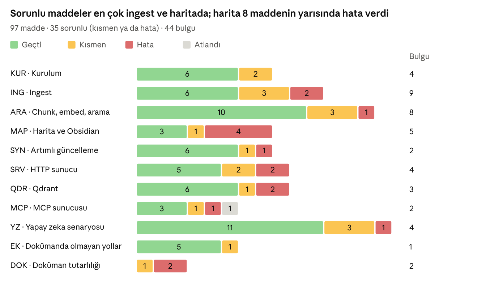
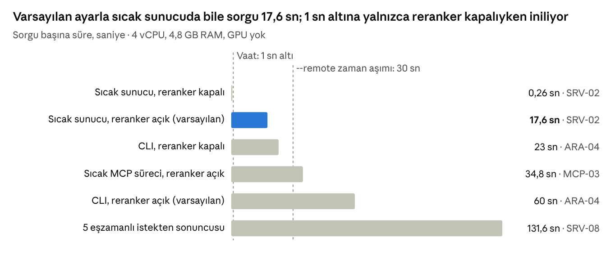

# doqqy Test Raporu

29 Ekim 2026 · Turhan Göksu

## Özet

doqqy'nin vaat ettiği özelliklerin çoğu bir Ubuntu sunucusunda çalışıyor. Ancak 97 test maddesinin 35'inde sorun çıktı ve 44 bulgu kaydedildi; bunların 9'u yüksek önemde. Testler 20–29 Ekim 2026'da, commit fd1ba07 (doqqy 0.1.6) üzerinde elle yapıldı.

97 maddenin 61'i geçti, 19'u kısmen geçti, 16'sı hata verdi ve 1'i atlandı. 44 bulgunun 9'u yüksek, 24'ü orta, 11'i düşük önemde; kritik bulgu yok.

- **Çekirdek çalışıyor.** Dokuz dosya formatının hepsi işlendi; Türkçe, İngilizce ve diller arası arama doğru belgeleri buluyor. sync, HTTP sunucusu, Qdrant, MCP ve bir yapay zeka ajanıyla kullanım çalışıyor.
- **CPU'da performans vaadin çok altında.** Sıcak sunucuda varsayılan sorgu 17,6 sn sürüyor (vaat: 1 sn'nin altı); 1 sn'nin altına yalnızca reranker kapatılınca iniliyor (0,26 sn). Her CLI sorgusu 60–93 sn, 35 sayfalık bir PDF \~10 dk sürüyor.
- **Bazı akışlar sessizce yanlış veri üretiyor.** USAGE'daki "doküman değişti" akışı silinen belgeleri yeniden indeksliyor. Büyük TXT dosyalarının çoğu aranamıyor. Harita aynı adlı dosyaları karıştırıyor. Açık kalan sunucu ve MCP süreci sonradan yapılan sync'i görmüyor.
- **İki opsiyonel özellik yeni kurulumda kırık.** Bağımlılık aralıklarında üst sınır olmadığı için `doqqy mcp` açılmıyor (mcp 2.x) ve PDF yedek ayrıştırıcısı boş bir paket kuruyor (pymupdf4llm 2.0). CI ikisini de yakalamıyor.
- **Güvenlik ve gizlilik vaatleri tam tutmuyor.** `--host 0.0.0.0` ile açılan sunucuda kimlik doğrulama yok. Her model yüklemesinde HuggingFace'e bağlanma denemesi oluyor. MCP ile kullanımda belge parçaları buluttaki modele gidiyor ve dokümanlar bundan söz etmiyor.
- **Dokümanlar güncel değil.** Çıkmış özellikler hâlâ "yapılacak" görünüyor ve sekiz sayısal vaatten dördü ölçümle tutmuyor.

Her maddenin komutları, çıktıları ve notları test defterinde: [test-notebook.html](test-notebook.html). GitHub HTML dosyalarını sayfa olarak göstermediği için dosyayı indirip tarayıcıda açın.

## Test ortamı ve yöntem

Testler, dokümanlardaki kurulum ve kullanım yönergeleri izlenerek bir Ubuntu sanal makinesinde elle yapıldı. Dokümanlar Windows/PowerShell için yazıldığı için komutlar Linux'a çevrildi; takılınan her yer kaydedildi.

| Bileşen | Değer |
| --- | --- |
| Ana makine | MacBook Air M3, 8 GB RAM |
| Sanal makine | Multipass; Ubuntu 24.04.5 LTS (aarch64); 4 vCPU, 4,8 GB RAM, 8 GB swap, 33 GB disk; GPU yok |
| doqqy | 0.1.6, commit fd1ba07 (17 Eylül 2026); Python 3.12.3, venv |
| Eklentiler | server, watch, qdrant, ocr, mcp, dev; mcp 2.3.0 geldi, 1.30.0'a düşürüldü (MCP-02) |
| Qdrant | Docker, qdrant/qdrant v1.13.2; qdrant-client 1.19.1 |
| Yapay zeka istemcileri | Claude Code 2.1.310 (VM ve Mac), Claude Desktop (Mac); model Claude Opus 5.5 |

**Corpus'lar**

- `~/corpus`: repodaki değerlendirme corpus'u (13 kurgusal "Nova Ticaret" belgesi), her formattan üretilmiş kurgusal dosyalar ve 5 gerçek dosya (CV, 35 sayfalık PDF, 20 MB DOCX, HTML, CSV). Toplam 41 belge, 239 chunk.
- `~/corpus2`: yalnızca ERP belgeleri; tek sunucuyla birden çok corpus testleri için.
- `~/corpus-nova`: yalnızca kurgusal belgeler (14). Yapay zeka senaryosunda parçalar buluta gittiği için gerçek dosyalar orada kullanılmadı.

**İş bölümü**

- Bütün test komutlarını Turhan Göksu VM'de kendisi çalıştırdı. Süreler `time` ile, bellek `/usr/bin/time -v` ile ölçüldü.
- Claude (Claude Code, Opus 5.5) repoyu inceleyip test planını ve komutları hazırladı, çıktılardan not ve bulgu taslakları yazdı ve bu raporu derledi. Görevin istediği gibi dokümanda olmayan kullanım yollarını ve yapay zeka senaryosunu da o önerdi.
- Kod incelemesinden çıkan beklentiler defterde "Şüphe" olarak işaretlendi ve her biri elle doğrulandı ya da çürütüldü.
- Son gün, Turhan'ın isteğiyle ortam temizliği ve bir Claude Desktop oturum kaydının incelenmesi Claude'a yaptırıldı (MCP-06).

**Durum ve önem tanımları**

| Durum | Anlamı |
| --- | --- |
| Geçti | Adım dokümandaki gibi çalıştı. Yan bir sorun çıktıysa ayrıca bulgu olarak kaydedildi (13 madde). |
| Kısmen | Çalıştı, ama vaadin bir kısmı tutmadı ya da ek adım gerekti. |
| Hata | Dokümandaki gibi çalışmadı ya da yanlış sonuç verdi. |
| Atlandı | Gerekçesi notta yazılı olarak yapılmadı. |

| Önem | Kullanılan ölçüt |
| --- | --- |
| Yüksek | Varsayılan kullanımda yanlış ya da eksik sonuç, güvenlik açığı veya ana bir özelliğin çalışmaması |
| Orta | Belirli koşulda ortaya çıkan ya da geçici çözümü olan sorun |
| Düşük | Doküman, mesaj ya da kullanım kolaylığı sorunu |

## Kapsam ve sonuçlar

Test, dokümanlarda anlatılan bileşenlerin hepsini 11 bölümde, 97 maddeyle kapsadı. Sorunlar en çok ingest, harita ve HTTP sunucu bölümlerinde toplandı.

_Kaynak: doqqy Test Defteri, 29 Ekim 2026 · 97 madde, 44 bulgu_

- **Kurulum:** Çalışıyor, ama dokümanlar PowerShell için yazılmış. GPU'suz makinede 4,1 GB CUDA kütüphanesi iniyor; "hızlı" testler 6,4 GB model indiriyor.
- **Ingest:** Dokuz formatın hepsi işlendi. Silinen kaynakların çıktısı temizlenmiyor, cp1254 Türkçe metin bozuluyor, PDF yedek ayrıştırıcısı kırık.
- **Chunk, embed ve arama:** Hibrit arama ve reranker doğru belgeleri öne çıkarıyor. Büyük TXT dosyaları aranamıyor, ilgisiz sonuçlar için eşik yok.
- **Harita ve Obsidian:** Harita üretiliyor ve Obsidian'da açılıyor. Aynı adlı dosyalar, alt çizgili adlar, inject döngüsü ve INDEX.md sızıntısı yanlış bağlantı üretiyor.
- **Artımlı güncelleme:** sync ekleme, değiştirme, silme ve kopya belgeleri doğru işliyor. watch çalışıyor ama çıktısı gürültülü.
- **HTTP sunucu:** Modelleri bellekte tutuyor ve eşzamanlı isteklerde çökmüyor. Varsayılan sorgu \~17 sn, başka süreçlerin sync'ini görmüyor, ağa açıkken kimlik doğrulama yok.
- **Qdrant:** Embed, sorgu, migrate-store, değerlendirme ve entegrasyon testleri çalışıyor. Corpus klasörü taşınınca veri sessizce kayboluyor.
- **MCP:** mcp 1.x ile üç araç da çalışıyor; varsayılan kurulumda (mcp 2.x) sunucu açılmıyor.
- **Yapay zeka senaryosu:** Doğru kurulumla 10 sorunun 10'u doğru; hatalar kurulumdan ve güncellikten geldi.
- **Dokümanda olmayan yollar:** Sekiz yolun altısı sorunsuz çalıştı.
- **Doküman tutarlılığı:** Üç kontrolün üçü de çelişki buldu.

## Yüksek önemdeki bulgular

Dokuz yüksek önemli bulgunun altısı, kullanıcıya hata göstermeden yanlış ya da eksik sonuç üreten durumlar. Kalan üçü performans, güvenlik ve kurulumla ilgili. Parantez içindeki kod, test defterindeki madde numarası.

1. **Dokümandaki tam akış silinen belgeleri yeniden indeksliyor (ING-07).** `doqqy ingest`, `raw/` altından silinen kaynağın `processed/` çıktısını silmiyor. USAGE:294–297'nin önerdiği `ingest && chunk && embed` akışı bu yetim dosyayı yeniden embed ediyor. SYN-07'de silinen belge, ilgili sorgunun ilk 3 sonucunun üçünde de çıktı. Silmeyi doğru işleyen yol `doqqy sync`.
2. **Büyük TXT dosyalarının çoğu aranamıyor (ARA-08).** TXT içeriği tek bir kod bloğuna sarılıyor ve chunker kod bloklarını bölmüyor; koda göre XML de aynı. 31 KB'lık bir TXT tek chunk oldu (9.016 token) ve embed 1024 token'da kesti. İçeriğin yalnızca ilk \~%11'i aranabiliyor; `doqqy sync` bu kesmeyi uyarısız yapıyor.
3. **Farklı klasörlerdeki aynı adlı dosyaların bağlantıları karışıyor (MAP-06).** Harita ve inject belgeleri yalnızca dosya adıyla tanıyor. İki `politika.md` tek belge sayıldı; bölüm kimlikleri çakıştı ve ikisine de aynı bağlantı bloğu yazıldı. README.md gibi ortak adların olduğu gerçek corpus'larda bu sistematik hale gelir.
4. **inject'in eklediği linkler sonraki haritada "kesin referans" sayılıyor (MAP-07).** Pass 1, `## Bağlantılar` bloğundaki `[[...]]` linklerini hariç tutmuyor. map → inject → map döngüsünde açık referans sayısı, belgeler değişmeden 3'ten 81'e çıktı.
5. **INDEX.md ve bağlantı blokları indekse sızıyor (MAP-08).** `doqqy chunk` bunları hariç tutmuyor: 429 chunk'ın 132'si INDEX.md'den, 88'i bağlantı bloklarından geldi. Aramada var olmayan `raw/INDEX.md` kaynağı çıkıyor ve `doqqy sync` `processed/INDEX.md`'yi siliyor.
6. **Sıcak sunucuda varsayılan sorgu \~17 sn sürüyor (SRV-02).** Sürenin \~%98'i CPU'daki reranker'da geçiyor: 50 aday 4'lük gruplarla puanlanıyor ve bu sayılar kodda sabit (`config.RETRIEVAL_TOP_K`). Reranker kapatılınca sorgu 0,26 sn, ama LanceDB'de diller arası arama çöküyor (QDR-08).
7. **Açık sunucu ve MCP süreci başka süreçlerin sync'ini görmüyor (SRV-06).** LanceDB tablo bağlantısı süreç içinde önbelleğe alınıyor (`_TABLE_CACHE`). Sync ile eklenen belge çıkmıyor, silinen çıkmaya devam ediyor; ancak yeniden başlatma düzeltiyor. Aynısı Claude Code oturumunda da görüldü (YZ-12).
8. **`--host 0.0.0.0` ile açılan sunucuda kimlik doğrulama yok (SRV-07).** İstemci, sunucudaki herhangi bir indekslenmiş klasörü workspace olarak verebiliyor; testte başka bir corpus'un içeriği ağdan okundu. 404 ile 409 arasındaki fark dosya sisteminin yoklanmasına izin veriyor. Varsayılan 127.0.0.1 güvenli.
9. **Varsayılan kurulumda `doqqy mcp` açılmıyor (MCP-01).** `[mcp]` extra'sı `mcp>=1.29.0,<3` istiyor (Dependabot, d5a6ec2) ve mcp 2.x'te `mcp.server.fastmcp` modülü yok. Hata mesajı sorunu çözmeyen bir komut öneriyor. Geçici çözüm: `pip install "mcp>=1.29,<2"`.

Orta önemdekilerden özellikle dördü öne çıkıyor: PDF yedek ayrıştırıcısının boş paket kurması (ING-11), cp1254 kodlamalı Türkçe dosyaların bozulması (ING-09), çevrimdışı vaadi (EK-01) ve MCP'de gizlilik uyarısının olmaması (YZ-13). Bulguların tamamı Ek A'da.

## Gecikmeler

CPU'da varsayılan ayarla etkileşimli kullanım yavaş: sıcak sunucuda sorgu 17,6 sn, CLI'da 60 sn sürüyor. 1 sn'nin altına yalnızca reranker kapatılınca iniliyor.

_Kaynak: doqqy Test Defteri (SRV-02, ARA-04, MCP-03, SRV-08) · "fatura iptal onayı" ve "stok sayımı" sorguları_

Sürenin \~%98'i reranker'da geçiyor. Reranker kapatılınca ise LanceDB'de diller arası arama bozuluyor (QDR-08). CLI her sorguda modelleri baştan yüklüyor; günün ilk sorgusu 93 sn sürdü.

**Toplu işlemler**

| İşlem | Ölçülen | Dokümandaki beklenti | Madde |
| --- | --- | --- | --- |
| Temel kurulum (`pip install -e .`) | 14 dk 17 sn; `.venv` 6,6 GB, bunun 4,1 GB'ı CUDA | – | KUR-03 |
| "Hızlı" testler (`pytest -m "not slow"`) | 15 dk 2 sn; 6,4 GB model indirmesi dahil | Model indirmez | KUR-07 |
| 35 sayfalık PDF'in ingest'i | İlk çalıştırmada 15 dk 19 sn, sonra 9 dk 46 sn | 500 sayfa 15–30 dk | ING-02 |
| Embed, 206 chunk (CPU) | 9 dk 3 sn | 500 sayfa 15–30 dk | ARA-02 |
| Tam akış, 41 belge (ingest + chunk + embed) | \~27 dk | – | SYN-07 |
| Qdrant'a embed, 239 chunk | 14 dk 19 sn | – | QDR-02 |
| LanceDB'den Qdrant'a taşıma (`migrate-store`) | 2,5 sn | – | QDR-04 |
| Tek belgelik sync | 16–27 sn; çoğu model yükleme | – | SYN-02, YZ-12 |
| Sunucunun hazır olması | +8 sn (modeller disk önbelleğindeyken) | – | SRV-01 |
| Değerlendirme aracı (25 sorgu, iki mod) | LanceDB 28 dk 40 sn, Qdrant 17 dk 36 sn | – | QDR-08 |
| İnternetsiz sorgu | 48,7 sn; `HF_HUB_OFFLINE=1` ile 38,0 sn | – | EK-01 |
| Yapay zeka ajanının bir soruyu cevaplaması | 16 sn – 1 dk 33 sn, ortalama \~53 sn | – | YZ-14 |

## Yapay zekanın önerdiği, dokümanda olmayan kullanım yolları

Claude'un önerdiği sekiz kullanım yolunun altısı sorunsuz çalıştı, ikisi ek ayar gerektirdi. Hiçbiri dokümanlarda anlatılmıyor.

| Kullanım yolu | Madde | Sonuç | Gözlem |
| --- | --- | --- | --- |
| Sunucunun Swagger arayüzünden (`/docs`) arama | SRV-03, EK-05 | Geçti | Teknik olmayan biri için hazır bir arayüz; ancak workspace alanına sunucudaki mutlak yolu yazmak gerekiyor. |
| Tek sunucuyla birden çok corpus'a hizmet | EK-03 | Geçti | Üç corpus'un sonuçları karışmadı. Aynı özellik ağa açıkken güvenlik açığına dönüşüyor (SRV-07). |
| MCP araçlarını Python istemcisiyle çağırmak | MCP-03 | Geçti | Node.js gerektirmiyor; üç araç da çalıştı, sunucunun stderr çıktısı boş kaldı. |
| Başka bir bilgisayardan SSH üzerinden MCP | YZ-02, MCP-06 | Kısmen | Claude Code'da doğrudan çalıştı. Claude Desktop'ta parolalı anahtar için `-o UseKeychain=yes` gerekti. |
| Değerlendirme aracını kendi verisiyle çalıştırmak | QDR-08, EK-04 | Geçti | Recall@k ve MRR ölçüyor; tam çalıştırma LanceDB'de 28 dk 40 sn, Qdrant'ta 17 dk 36 sn. |
| İnternetsiz çalışma | EK-01 | Kısmen | Sorgu ve sync çalışıyor; ama her model yüklemesinde 3 HuggingFace denemesi oluyor. `HF_HUB_OFFLINE=1` belgelenmemiş. |
| Corpus'u paketleyip başka yere taşımak | EK-02 | Geçti | 491 KB'lık arşiv LanceDB'de sorunsuz çalıştı. Qdrant'ta veri klasörün yoluna bağlı kaldığı için taşınamaz (QDR-06). |
| Ağsız bir Docker konteynerinde çalıştırmak | EK-06 | Geçti | `--network none` ile sorgu 36,9 sn'de doğru sonucu verdi. "Veri makineden çıkmaz" vaadinin en güçlü kanıtı. |

## Yapay zeka kullanım senaryosu

Doğru kurulumla Claude Code ve doqqy, kurgusal şirket belgeleri üzerine sorulan 10 sorunun 10'unu doğru ve kaynak göstererek cevapladı; ortalama süre soru başına \~53 sn. Yanlış cevaplar kurulumdan ve doqqy'nin MCP davranışından geldi.

**Senaryo.** "Nova Ticaret" çalışanı, şirketin İK ve ERP belgelerine bir yapay zeka ajanıyla soru soruyor. Ajan Claude Code (Opus 5.5), doqqy'ye MCP üzerinden bağlı. Corpus yalnızca kurgusal belgelerden oluşuyor (13 belge, 92 chunk). Ajan yalıtıldı: `--strict-mcp-config` ile yalnızca doqqy bağlıydı, dosya araçları kapalıydı ve Claude corpus dışındaki bir klasörden başlatıldı. Bağlantı hem VM içinden (YZ-01) hem Mac'ten SSH ile (YZ-02) kuruldu.

| Soru türü | Soru | doqqy çağrısı | Süre | Sonuç |
| --- | --- | --- | --- | --- |
| Durum (YZ-03) | doqqy'deki doküman deposunun durumunu özetle. Hangi etiketler var? | 2 | 16 sn | Doğru |
| İlk sorgu (YZ-04) | Fatura iptal süreci nasıl işliyor? | 1 | 50 sn | Doğru |
| Olgusal (YZ-05) | 5.000 TL ve üzerindeki bir faturanın iptalini kim onaylar? Onay 48 saat içinde gelmezse ne olur? | 1 | 43 sn | Doğru; belgedeki 48/72 saat çelişkisini de buldu |
| Dil tuzağı (YZ-06) | Who approves the cancellation of a 6,000 TL invoice at the Turkish company? | 3 | 1 dk 12 sn | Doğru; sorguyu Türkçeye çevirdi |
| Hesap (YZ-07) | Şirketimizde (Nova Ticaret) haftada 20 saat çalışan, 7 yıl kıdemli çalışanın yıllık izni kaç gün? | 2 | 36 sn | Doğru (10 gün). Şirket anılmayınca yanlış (20 gün) |
| Karşılaştırma (YZ-08) | Türkiye ve İngiltere şirketlerindeki izin süreçlerini karşılaştır. | 3 | 58 sn | Doğru (4 farkın 4'ü) |
| Etiket (YZ-09) | Sadece stok dokümanlarına bakarak: el terminali bağlantıyı kaybederse ne olur? | 2 | 30 sn | Doğru; `stok` etiketini kendisi kullandı |
| Kesin terim (YZ-10) | NOVA2026000123 numaralı fatura hangi dokümanda geçiyor? | 1 | 1 dk 5 sn | Doğru |
| Uydurma testi (YZ-11) | Nova Ticaret'te maaş bordrosu nasıl hesaplanıyor? (corpus'ta cevabı yok) | 3 | 1 dk 18 sn | Doğru: "belgelerde yok" |
| Canlı güncelleme (YZ-12) | Nova Ticaret'te evlilik izni kaç gün? (oturum açıkken eklenen belge) | 3, sonra 1 | 1 dk 33 sn, 1 dk 21 sn | Yanlış; MCP yeniden bağlanınca doğru |

**Gözlemler**

- **Ajan düz aramaya değer katıyor.** Dil tuzağı sorusunda `doqqy query` ilk 3 sonucun üçünü de İngiliz belgesinden getirdi ve yanlış cevaba götürürdü. Cevabı olmayan soruda düz arama ilgisiz sonuçları normal sonuç gibi gösterdi; ajan "belgelerde yok" dedi.
- **USAGE'daki kurulumda ajan doqqy'yi atlıyor (YZ-05).** Claude corpus klasöründen başlatılınca dosyaları doğrudan tarayıp okudu; bu durumda belgelerin tamamı buluta gidiyor.
- **Soru şirketi anmazsa doqqy çağrılmıyor (YZ-07).** MCP sunucusu corpus'u tanıtan bir açıklama göndermiyor; ajan soruyu genel bilgi sorusu sanıp kanundan çelişkili bir cevap verdi.
- **Açık MCP süreci yeni belgeleri görmüyor (YZ-12).** Sync ile eklenen belge, oturum yeniden bağlanıncaya kadar bulunamadı (SRV-06 ile aynı kök neden).
- **Gizlilik (YZ-13).** doqqy yerel çalışıyor, ama getirdiği parçalar cevap için buluttaki modele gidiyor. Varsayılan Claude Code kurulumunda hesaba bağlı Gmail, Drive ve Calendar bağlayıcıları da ajana açık.
- **Claude Desktop (MCP-06).** Elle JSON yapılandırması çalıştı, ama SSH için ek ayar gerekti ve reranker açıkken ilk iki sorgu zaman aşımına uğradı. Bağlantı kurulamadığında ajan kullanıcıya sormadan Spotlight ve Google Drive'da arama yaptı.

Bedeli: soru başına yaklaşık 1 dk bekleme, getirilen parçaların buluta gitmesi ve dikkatli bir kurulum gereksinimi (yalıtım, şirket bağlamı, sync sonrası yeniden bağlanma).

## Doküman tutarlılığı

Dokümanların sekiz sayısal vaadinden dördü ölçümle tutmuyor ve 12 başlıkta toplanan talimatlar yazıldığı gibi çalışmıyor. Ayrıca çıkmış özellikler hâlâ "yapılacak" olarak anılıyor. Satır numaraları commit fd1ba07'ye göre.

**Sayısal vaatler ve ölçülen değerler (DOK-02)**

| Vaat | Kaynak | Ölçülen | Sonuç |
| --- | --- | --- | --- |
| Model indirme \~2 GB, ilk embed'de | README:39, USAGE:32, ARCHITECTURE:291 | 6,4 GB; docling modelleriyle 6,9 GB (KUR-07, ING-02) | Tutmuyor |
| Soğuk CLI sorgusu \~20–60 sn | USAGE:186, README:117 | Reranker ile 60–93 sn, olmadan 23 sn (ARA-04) | Tutmuyor |
| Sıcak sorgu 1 sn'nin altında | USAGE:199, ARCHITECTURE:289 | Reranker ile 17,6–21,5 sn, olmadan 0,26 sn (SRV-02) | Yalnızca reranker kapalıyken |
| 500 karma sayfa 15–30 dk (2–4 sn/sayfa) | ARCHITECTURE:285 | 35 sayfalık PDF 9 dk 46 sn, \~16,7 sn/sayfa (ING-02) | Tutmuyor |
| Chunk 1 dk'nın altında | ARCHITECTURE:286 | 206 chunk 1,6 sn (ARA-01) | Tutuyor |
| Embed (CPU) 15–30 dk | ARCHITECTURE:287 | 206 chunk 9 dk 3 sn; 500 sayfaya oranla \~15 dk (ARA-02) | Tutuyor |
| RAM'i sınırlı varsayılanlar | README:104, ARCHITECTURE:118 | Embed 2,9 GB; sorgu 4,3 GB, ingest 4,7 GB (4,8 GB'lık VM'de) | Kısmen |
| Değerlendirme sonuçları | VECTOR-STORE-ADAPTERS:231 | Reranker açıkken birebir; kapalıyken Qdrant MRR 0,7593 (yazılan 0,7793) | Kısmen |

Performans tablosu (ARCHITECTURE §5) sayıların hangi donanımda ölçüldüğünü belirtmiyor.

**Yazıldığı gibi çalışmayan talimatlar (DOK-03)**

- Kurulum yalnızca PowerShell için yazılmış; Ubuntu'da `python` komutu ve `python3-venv` paketi eksik (KUR-02, KUR-06).
- Kurulum bölümünde `.[server]` yok (KUR-05). USAGE:272 "mcp<2" diyor, pyproject "<3" kuruyor ve `doqqy mcp` açılmıyor (MCP-01, MCP-05).
- CLAUDE.md ve DEVELOPER-HANDOVER, "not slow" testlerin model indirmediğini söylüyor; 6,4 GB indi (KUR-07).
- `--ocr` (USAGE:81, 373) taranmış PDF'te etkisiz, çünkü docling zaten OCR yapıyor (ING-04).
- USAGE:373 ve hata mesajı yedek ayrıştırıcı için `.[pdf-fallback]` öneriyor; bu extra artık boş bir paket kuruyor (ING-11).
- "Documents added or changed" akışı (USAGE:294–297) silinen belgeleri yeniden indeksliyor ve INDEX.md'yi indekse sokuyor (ING-07, SYN-07, MAP-08).
- FAQ'deki hata mesajı (USAGE:369) gerçekte görülenle aynı değil (ARA-09); §5'teki Python örneği yazıldığı gibi çöküyor (ARA-12).
- watch'un "tek özet satırı" (USAGE:161) model yükleme çıktısının arasında kayboluyor (SYN-08).
- `claude mcp add doqqy -- doqqy mcp` (USAGE:401) yalnızca venv açıkken çalışıyor (YZ-01). §7 sunucudaki bir doqqy'ye bağlanmayı anlatmıyor (MCP-06).
- `--host` yalnızca "custom host" diye geçiyor (USAGE:206); kimlik doğrulama olmadığı yazmıyor (SRV-07).
- "Fully offline" (README:39, USAGE:32) ve "no external API calls" (README:126): her model yüklemesinde HuggingFace'e bağlanma denemesi var (EK-01).
- ".doqqy/ can be zipped and moved" (ARCHITECTURE:276) LanceDB'de doğru, Qdrant'ta değil (EK-02, QDR-06).

**Güncel olmayan metin (DOK-01).** USAGE:294 "no incremental mode yet", USAGE:371 "serve mode is on the roadmap" diyor; README yol haritasında Qdrant, serve ve sync/watch hâlâ yapılacaklar arasında. Desteklenen formatlar üç yerde farklı sayılıyor (beş, sekiz, dört; gerçekte dokuz). `.env.example`, kodda hiç kullanılmayan GEMINI ve ANTHROPIC API anahtarlarını "harita için gerekli" diye istiyor.

**Dokümanda hiç geçmeyen davranışlar:** Swagger arayüzü `/docs`, tek sunucuyla birden çok corpus, `python -m tests.eval` değerlendirme aracı, `HF_HUB_OFFLINE`, sunucunun ve MCP sürecinin başka süreçlerin sync'ini görmemesi ve Qdrant'ta verinin klasörün mutlak yoluna bağlı olması.

## Öncelikli öneriler

En hızlı kazanç, iki bağımlılığın üst sınırını düzeltmek ve USAGE'daki "doküman değişti" akışını `doqqy sync` ile değiştirmek. Öneriler bulgulardan çıkarıldı; çözümün biçimi geliştiricilerin kararı.

1. **Bağımlılıkları sabitlemek.** `mcp>=1.29,<2` ve `pymupdf4llm>=0.0.17,<2` (ya da kodu mcp 2.x ve PyMuPDF 2.x'e taşımak). CI'a `[mcp]` ve `[pdf-fallback]` extra'larını ve MCP entegrasyon testlerini eklemek (MCP-01, ING-11, MCP-05).
2. **Sessiz veri hatalarını kapatmak.** ingest silinen kaynakların çıktısını temizlemeli; chunk INDEX.md'yi ve bağlantı bloklarını hariç tutmalı. Harita belgeleri tam yoluyla tanımalı ve inject bloklarını Pass 1'e katmamalı. Büyük TXT/XML blokları bölünmeli ve sync de kesme uyarısı vermeli (ING-07, MAP-06, MAP-07, MAP-08, ARA-08).
3. **Sunucu ve MCP'nin güncel kalması.** LanceDB tablo önbelleği başka süreçlerin yazdıklarını algılamalı ya da doküman yeniden başlatmayı açıkça söylemeli (SRV-06, YZ-12).
4. **CPU performansı.** Reranker aday sayısı ve grup boyutu ayarlanabilir olmalı. `--remote` zaman aşımı ayarlanabilmeli ve traceback yerine düzgün bir mesaj vermeli. Dokümandaki süreler, ölçüldükleri donanımla birlikte güncellenmeli (SRV-02, SRV-05, ARA-04).
5. **Güvenlik ve gizlilik.** `--host 0.0.0.0` için kimlik doğrulama ya da en azından workspace izin listesi ve uyarı gerekli. Çevrimdışı mod (`HF_HUB_OFFLINE`) varsayılan olmalı ya da belgelenmeli. MCP bölümüne gizlilik uyarısı ve yalıtılmış bir kurulum örneği eklenmeli (SRV-07, EK-01, YZ-13, YZ-05).
6. **Türkçe desteği.** TXT, MD ve XML için yedek kodlama cp1254 olmalı; Pass 1 kalıbı Ö, Ş, Ç, Ü, İ ile başlayan dosya adlarını tanımalı (ING-09, MAP-02).
7. **MCP sunucusunun kendini tanıtması.** FastMCP'ye corpus'u anlatan bir `instructions` metni vermek, ajanın şirket sorularında doqqy'yi seçmesini kolaylaştırır (YZ-07).
8. **Dokümanları güncellemek.** Linux kurulum komutları, format listeleri, yol haritası, `.env.example`, sayısal vaatler ve sunucudaki doqqy'ye MCP ile bağlanma (DOK-01, DOK-02, DOK-03, MCP-06).

## Test edilmeyenler

Windows ve GPU, test ortamında bulunmadıkları için kapsam dışında kaldı; diğerleri gerekçesiyle atlandı ya da başka bir yoldan karşılandı.

| Konu | Sebep |
| --- | --- |
| Windows ve PowerShell (dokümanların ana platformu) | Görev sunucuda test istiyordu; ortam Mac üzerinde bir Ubuntu VM'iydi. |
| GPU ve CUDA | Makinede GPU yok; bütün süreler CPU'da ölçüldü. |
| Python 3.10 ve 3.11 | CI zaten 3.10'u test ediyor. Testler, CI'ın hiç denemediği 3.12'de yapıldı. |
| python-pptx yedek ayrıştırıcısı | Tetiklenemiyor: docling'in PPTX okuyucusu da python-pptx kullanıyor (ING-11). |
| Cursor ve Windsurf | Aynı JSON yapılandırmasını kullanan Claude Desktop ile test edildi (MCP-06). |
| MCP Inspector | Node.js gerektiriyor; araçlar Python MCP istemcisiyle test edildi (MCP-03, MCP-04). |
| Değerlendirme aracının kendi soru setiyle tam çalıştırılması | Yalnızca seçenekleri incelendi (EK-04); repodaki setle tam çalıştırıldı (QDR-08). |
| Büyük corpus | Corpus 41 belge ve 239 chunk'tan oluşuyordu; on binlerce chunk'lık ölçek denenmedi. |
| Uzun süreli ve çok kullanıcılı kullanım | Yalnızca 5 eşzamanlı istek denendi (SRV-08). |

VM'in DNS çözümlemesi test boyunca kesintiliydi; model yüklemesi içeren bazı süreler bundan etkilenmiş olabilir (EK-01).

## Ekler

**Ek A. Bulguların tamamı (44)**

Önem sırasına, sonra madde sırasına göre. Her bulgunun ayrıntısı ve kanıtı test defterinde.

| Önem | Madde | Alan | Bulgu |
| --- | --- | --- | --- |
| Yüksek | ING-07 | Ingest | ingest silinen kaynakların çıktılarını temizlemiyor; USAGE'daki tam akış silinen belgeleri yeniden indeksliyor |
| Yüksek | ARA-08 | Arama | Büyük TXT dosyalarının içeriğinin çoğu aranamıyor; sync uyarı bile vermiyor |
| Yüksek | MAP-06 | Harita | Farklı klasörlerdeki aynı adlı dosyaların bağlantıları birbirine karışıyor |
| Yüksek | MAP-07 | Harita | inject'in eklediği linkler sonraki map'te "kesin referans" sayılıyor |
| Yüksek | MAP-08 | Harita | INDEX.md ve bağlantı blokları indekse sızıyor; sync INDEX.md'yi siliyor |
| Yüksek | SRV-02 | Performans | Sıcak sunucuda bile sorgu \~17 sn sürüyor; "<1 sn" vaadi yalnızca reranker kapalıyken tutuyor |
| Yüksek | SRV-06 | HTTP sunucu | Sunucu ve MCP süreci, kendileri açıkken yapılan sync'i görmüyor; eklenen belgeler çıkmıyor, silinenler çıkmaya devam ediyor |
| Yüksek | SRV-07 | Diğer | --host 0.0.0.0 ile açılan sunucuda kimlik doğrulama yok; sunucudaki her indekslenmiş klasör ağdan okunabiliyor |
| Yüksek | MCP-01 | MCP | Varsayılan kurulumda doqqy mcp çalışmıyor (mcp 2.x uyumsuz); hata mesajı yanlış çözüm öneriyor |
| Orta | KUR-02 | Doküman | Kurulum komutları Ubuntu'da doğrudan çalışmıyor |
| Orta | KUR-03 | Kurulum | GPU'suz makinede gereksiz CUDA kütüphaneleri iniyor |
| Orta | ING-02 | Performans | PDF ingest dokümandaki vaadin çok altında |
| Orta | ING-03 | Ingest | mammoth yedeğinde DOCX tabloları dağılıyor, noktalama bozuluyor |
| Orta | ING-04 | Doküman | --ocr bayrağı etkisiz; taranmış PDF zaten OCR'lanıyor |
| Orta | ING-05 | Ingest | Hata mesajları yanıltıcı; ekrandaki kurulum komutu bozuk |
| Orta | ING-08 | Ingest | --source corpus dışında çalışmıyor, içinde ise klasör yapısını bozuyor |
| Orta | ING-09 | Ingest | Windows-1254 kodlamalı Türkçe dosyalar sessizce bozuluyor |
| Orta | ING-11 | Ingest | \[pdf-fallback\] extra'sı boş bir paket kuruyor; PDF yedek ayrıştırıcısı sessizce devre dışı kalıyor |
| Orta | ARA-01 | Arama | Yalnızca başlıktan oluşan, içeriksiz chunk'lar |
| Orta | ARA-02 | Arama | Chunk'lar karakterle sınırlanıyor; bazılarının sonu aranamıyor |
| Orta | ARA-04 | Performans | Her CLI sorgusu 1–1.5 dk ve \~4.3 GB bellek harcıyor |
| Orta | ARA-07 | Arama | Yakın konulu belgelerde yanlış sonuç 1. sıraya çıkıyor |
| Orta | ARA-08 | Arama | Alakasız sonuçlar "sonuç yok" yerine düşük skorla dönüyor |
| Orta | ARA-09 | Arama | Ön koşul hataları traceback olarak geliyor; sorgu hata vermeden önce modeli yüklüyor |
| Orta | MAP-02 | Harita | Açık referanslar Türkçe karakterli dosya adlarını tanımıyor |
| Orta | MAP-05 | Harita | Alt çizgili dosya adları bozuk wikilink üretiyor |
| Orta | SRV-05 | HTTP sunucu | --remote sorgusu sunucu açılırken ya da meşgulken 30 sn'de Python traceback'iyle düşüyor |
| Orta | QDR-06 | Qdrant | Qdrant'ta corpus klasörü taşınınca ya da yeniden adlandırılınca veri sessizce kayboluyor |
| Orta | QDR-08 | Arama | Reranker kapalıyken varsayılan backend'de (LanceDB) diller arası arama çalışmıyor |
| Orta | YZ-05 | MCP | Önerilen Claude Code kurulumunda ajan doqqy'yi atlayıp belgeleri doğrudan okuyor |
| Orta | YZ-07 | MCP | Soru şirketi ya da doqqy'yi anmadığında ajan doqqy'yi kullanmıyor ve genel bilgiden çelişkili cevap veriyor |
| Orta | YZ-13 | MCP | MCP ile kullanıldığında belge parçaları buluttaki yapay zeka modeline gidiyor; dokümanlar bunu belirtmiyor |
| Orta | EK-01 | Diğer | "Tamamen çevrimdışı" vaadi tam doğru değil: doqqy her model yüklemesinde HuggingFace'e bağlanmaya çalışıyor |
| Düşük | KUR-04 | Doküman | README komut listesi eksik, CLI'da --version yok |
| Düşük | KUR-07 | Doküman | "Hızlı" testler 6.4 GB model indiriyor |
| Düşük | ING-03 | Ingest | pandoc ingest sırasında sessizce internetten indiriliyor |
| Düşük | ARA-12 | Doküman | USAGE'daki Python örneği yazıldığı gibi çöküyor |
| Düşük | SYN-06 | Sync / watch | Yalnızca sync ile kurulan corpus'ta chunks.parquet oluşmuyor; info yanlış durum gösteriyor, embed ile kurtarma çalışmıyor |
| Düşük | SYN-08 | Sync / watch | watch "tek özet satırı" yazmıyor: her sync'te model yükleme kalabalığı var, bozuk dosyada traceback ekrana dökülüyor |
| Düşük | QDR-04 | Sync / watch | doqqy embed manifest'teki kopya (alias) kayıtlarını siliyor; sonraki sync kopyaları gereksiz yere yeniden işliyor |
| Düşük | MCP-06 | MCP | Sunucuda çalışan doqqy'ye bir yapay zeka istemcisinden bağlanmanın belgelenmiş bir yolu yok |
| Düşük | YZ-01 | Doküman | USAGE'daki MCP kurulum komutu yalnızca venv açıkken çalışıyor |
| Düşük | DOK-01 | Doküman | .env.example, kodda hiç kullanılmayan LLM API anahtarlarını "harita için gerekli" diye istiyor |
| Düşük | DOK-01 | Doküman | Dokümanlar güncel değil: çıkmış özellikler "yapılacak" görünüyor, desteklenen formatlar üç yerde farklı sayılıyor |

**Ek B. Madde sonuçları (97)**

Süre, maddenin test edilmesinin aldığı zamanı gösteriyor; bazılarında kurulum ve ölçüm düzeni de dahil. "(tamamlama)" maddeleri, kapsam kontrolünden sonra son günlerde eklendi.

| Madde | Test | Durum | Süre |
| --- | --- | --- | --- |
| KUR-01 | Sanal makine ve Python sürümü | Geçti | - |
| KUR-02 | Sistem paketleri | Kısmen | - |
| KUR-03 | Repo, sanal ortam ve temel kurulum | Geçti | 14 dk 17 sn |
| KUR-04 | CLI açılışı ve komut listesi | Geçti | 0.25 sn |
| KUR-05 | Opsiyonel extra'lar | Geçti | 43 sn |
| KUR-06 | Doküman komutlarının Linux karşılıkları | Kısmen | - |
| KUR-07 | Birim testleri ve linter | Geçti | 15 dk 2 sn |
| KUR-08 | HF\_HOME ile model önbelleğini taşımak (tamamlama) | Geçti | \~2 dk |
| ING-01 | Hazır corpus ile ilk ingest | Geçti | 0.21 sn |
| ING-02 | Her formattan bir dosya | Geçti | 15 dk 54 sn |
| ING-03 | Pandoc yokken DOCX | Geçti | 9 sn (pandoc indirme); mammoth'a geçiş anında |
| ING-04 | Taranmış (resim) PDF ve OCR | Kısmen | 32 sn (--ocr olmadan) / 11 sn (--ocr ile) |
| ING-05 | Bozuk dosyalar ve hata izolasyonu | Geçti | 15.6 sn |
| ING-06 | Klasör adlarından tag üretimi | Geçti | 14.5 sn |
| ING-07 | Aynı adlı kaynaklar (rapor.pdf + rapor.docx) | Kısmen | her tur \~14 sn |
| ING-08 | --limit ve --source | Kısmen | her çalıştırma 1 sn'nin altında |
| ING-09 | Türkçe karakter kodlaması (cp1254) | Hata | 13 sn |
| ING-10 | Tekrar çalıştırma (idempotency) | Geçti | 10 dk 14 sn |
| ING-11 | Yedek ayrıştırıcılar: pymupdf4llm ve python-pptx (tamamlama) | Hata | \~5 dk |
| ARA-01 | Chunk | Geçti | 1.6 sn |
| ARA-02 | İlk embed: süre ve bellek | Geçti | 9 dk 3 sn |
| ARA-03 | İlk sorgu (soğuk başlangıç) | Geçti | 1 dk 33 sn |
| ARA-04 | Soğuk/sıcak süre ve --no-rerank | Geçti | 60 sn (rerank ile) / 23 sn (--no-rerank) |
| ARA-05 | Görüntüleme seçenekleri | Geçti | sorgu başına \~23 sn (--no-rerank) |
| ARA-06 | Tag filtresi | Geçti | sorgu başına \~23 sn; geçersiz tag anında |
| ARA-07 | Anlamsal ve diller arası arama | Kısmen | sorgu başına \~1 dk |
| ARA-08 | Büyük TXT dosyasının sonu | Hata | sync 27 sn |
| ARA-09 | Yanlış klasörde ve eksik adımla çalıştırma | Kısmen | query 17.8 sn, diğerleri 1 sn'nin altında |
| ARA-10 | tags ve info | Geçti | anında |
| ARA-11 | Kopya dokümanlar (dedup) | Geçti | sync 32 sn |
| ARA-12 | Python API (USAGE §5) | Kısmen | 1 dk 1 sn (örnek) + 49 sn (düzeltilmiş hâli) |
| ARA-13 | mammoth çıktısındaki kontrol kodu aranabiliyor mu? | Geçti | \~3 dk (ayrı klasörde ingest + chunk + embed + 2 sorgu) |
| ARA-14 | Bozuk kodlanmış Türkçe belgeler aranabiliyor mu? | Geçti | sorgu başına \~1 dk |
| MAP-01 | Harita üretimi ve seçenekleri | Geçti | her çalıştırma 0.9–2.2 sn |
| MAP-02 | Açık referanslar (Pass 1) | Kısmen | sync + map \~30 sn |
| MAP-03 | INDEX.md ve wikilink enjeksiyonu | Geçti | her komut 1 sn'nin altında |
| MAP-04 | Obsidian'da görsel kontrol | Geçti | - |
| MAP-05 | Alt çizgili dosya adı | Hata | sync + map + inject \~35 sn |
| MAP-06 | Farklı klasörde aynı adlı dosyalar | Hata | sync + map + inject \~35 sn |
| MAP-07 | map → inject → map döngüsü | Hata | tur başına \~2 sn |
| MAP-08 | INDEX.md'nin indekse sızması | Hata | chunk + embed 16 dk |
| SYN-01 | Başlangıç durumu | Geçti | anında |
| SYN-02 | Ekleme, değiştirme, silme | Geçti | \~3 dk |
| SYN-03 | Taşıma ve yeniden adlandırma | Geçti | \~3 dk |
| SYN-04 | Sync haritayı güncellemiyor | Geçti | \~2 dk |
| SYN-05 | Kanonik kopyanın silinmesi | Geçti | \~2 dk |
| SYN-06 | Sadece sync ile yeni corpus | Kısmen | \~3 dk |
| SYN-07 | Silme + tam akış (sync olmadan) | Hata | \~28 dk |
| SYN-08 | watch | Geçti | \~25 dk (editör sorunlarıyla birlikte; asıl test \~6 dk) |
| SRV-01 | Açılış ve sağlık uçları | Geçti | \~15 dk (ölçüm düzeniyle uğraşma dahil) |
| SRV-02 | curl ile sorgu | Kısmen | \~5 dk |
| SRV-03 | Hata kodları ve Swagger arayüzü | Geçti | \~10 dk |
| SRV-04 | --remote ile ince istemci | Geçti | \~5 dk |
| SRV-05 | Hazır olmadan sorgu ve zaman aşımı | Hata | \~20 dk (port karışıklığı dahil) |
| SRV-06 | Sunucu açıkken yapılan sync | Hata | \~5 dk |
| SRV-07 | Ağa açma ve güvenlik | Kısmen | \~5 dk |
| SRV-08 | Eşzamanlı istekler | Geçti | \~5 dk |
| SRV-09 | Özel port ve --remote URL (tamamlama) | Geçti | \~1 dk |
| QDR-01 | Qdrant'ı başlat | Geçti | \~3 dk |
| QDR-02 | Qdrant'a embed ve sorgu | Geçti | \~17 dk |
| QDR-03 | Ayarlar: ortam değişkeni ve .env | Geçti | \~2 dk |
| QDR-04 | migrate-store | Geçti | \~5 dk |
| QDR-05 | Qdrant kapalıyken | Kısmen | \~3 dk |
| QDR-06 | Corpus klasörünü taşımak | Hata | \~3 dk |
| QDR-07 | qdrant-client kurulu değilken | Hata | \~3 dk |
| QDR-08 | Değerlendirme aracı (opsiyonel) | Geçti | LanceDB 28 dk 40 sn, Qdrant 17 dk 36 sn |
| QDR-09 | Qdrant entegrasyon testleri (tamamlama) | Geçti | \~1 dk |
| MCP-01 | Varsayılan kurulumla doqqy mcp | Hata | \~1 dk |
| MCP-02 | Geçici çözüm: mcp 1.x | Geçti | \~2 dk |
| MCP-03 | Python MCP istemcisiyle araçlar (dokümanda yok) | Geçti | \~3 dk |
| MCP-04 | MCP Inspector (opsiyonel, dokümanda yok) | Atlandı | - |
| MCP-05 | USAGE'daki MCP entegrasyon testleri (tamamlama) | Geçti | 1 dk 15 sn |
| MCP-06 | Elle JSON yapılandırması: Claude Desktop (tamamlama) | Kısmen | \~20 dk (iki deneme) |
| YZ-00 | Hazırlık: Nova corpus'u ve Claude Code | Geçti | \~4 dk |
| YZ-01 | Bağlantı A: Claude Code VM içinde | Kısmen | \~10 dk (Claude Code kurulumu ve PATH sorunu dahil) |
| YZ-02 | Bağlantı B: kendi bilgisayarından SSH ile (dokümanda yok) | Geçti | \~15 dk (Claude Code CLI kurulumu dahil); soru 1 dk 0 sn |
| YZ-03 | Durum soruları | Geçti | 16 sn |
| YZ-04 | İlk sorgunun gecikmesi | Geçti | 50 sn |
| YZ-05 | Olgusal soru | Geçti | 43 sn |
| YZ-06 | Dil tuzağı (İngilizce soru, Türkçe belge) | Geçti | 1 dk 12 sn (/clear sonrası); bağlamdan verilen ilk cevap 4 sn |
| YZ-07 | Hesap gerektiren soru | Kısmen | 13 sn (ilk soru), 36 sn (şirket adıyla) |
| YZ-08 | Belgeler arası karşılaştırma | Geçti | 58 sn |
| YZ-09 | Etiket kullanımı | Geçti | 30 sn |
| YZ-10 | Kesin terim araması | Geçti | 1 dk 5 sn |
| YZ-11 | Uydurma testi | Geçti | 1 dk 18 sn |
| YZ-12 | Canlı güncelleme | Hata | 1 dk 33 sn (eski süreç) + 1 dk 21 sn (Reconnect sonrası) |
| YZ-13 | Gizlilik değerlendirmesi | Kısmen | - |
| YZ-14 | Senaryo özeti | Geçti | \~2 dk (karşılaştırma sorguları) |
| EK-01 | İnternetsiz çalışma | Kısmen | 5 dk |
| EK-02 | Corpus'u paketleyip taşımak | Geçti | \~1 dk |
| EK-03 | Tek sunucu, birden çok corpus | Geçti | \~2 dk |
| EK-04 | Kendi soru setiyle değerlendirme (opsiyonel) | Geçti | \~1 dk |
| EK-05 | Swagger arayüzünden arama | Geçti | - |
| EK-06 | doqqy'yi ağsız bir Docker konteynerinde çalıştırmak | Geçti | \~3 dk |
| DOK-01 | Henüz teyit edilmemiş metin çelişkileri | Hata | \~2 dk |
| DOK-02 | Sayısal vaatler ve ölçülen değerler | Kısmen | \~5 dk |
| DOK-03 | Yazıldığı gibi çalışmayan talimatlar ve belgelenmemiş davranışlar | Hata | \~5 dk |
